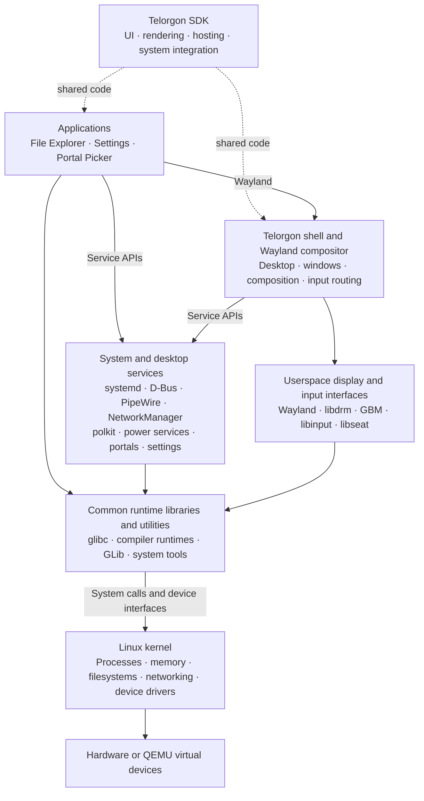

# System architecture

The default product uses the Telorgon bootloader, framework and applications.
The distro owns package recipes, Python coordination, image profiles and guest
system policy. [Source modules](sources.md) identifies the component repositories.

Start with the [runtime layers](#runtime-layers), then use the
[component reference](#component-reference) for each package, source module,
bundled service and guest policy file. The [boot and assembly reference](#boot-and-assembled-system-pieces)
explains the pieces that connect them into a bootable system.

## Runtime layers

Linux supplies scheduling, memory, filesystems, networking and device drivers.
The userspace above it supplies services, a graphical environment and applications.
The desktop combines standard Linux services with the project's own Telorgon
framework, shell and applications.

Solid arrows show major runtime relationships; dotted arrows show shared SDK
code. This is a structural overview, not a complete dependency graph or a rule
that every operation passes through every layer. Applications and services also
use kernel facilities directly.

| Part | Responsibility |
| --- | --- |
| Linux | Owns hardware drivers and the core process, memory, storage and network mechanisms |
| System foundation | glibc provides the C runtime; systemd starts services; udev discovers devices; logind manages sessions; D-Bus carries service messages |
| Desktop services | Manage audio, network connections, power, authorization, portals and shared settings through service APIs |
| Telorgon SDK | Shared Rust code for UI, rendering, application hosting, compositor support and system integration; also provides boot UI support |
| Telorgon shell | Uses the SDK to implement the desktop and Wayland compositor, including window management and input routing |
| Applications | Separate programs using the SDK for their interfaces, Wayland for windows and service APIs for system controls |

The SDK is used by both the shell and applications; it is not a separate
background process between them. The compositor implementation belongs to the
SDK, while the shell supplies the desktop UI and behavior. For
example, a network control in Settings uses NetworkManager's service API;
NetworkManager configures networking through Linux's kernel interfaces.

## Complete component map

The [component architecture](components.md) expands this overview into every
declared package recipe and every registered component repository, categorized
by function. It includes a full-size SVG and a linked text index for libraries,
services, tools and data. Boot, development and alternate-provider components
have separate bands so their roles remain clear.

Profiles select which catalog components enter an image. The map's coverage is
checked against the package and source manifests; versions, source pins and
dependency declarations remain authoritative there.

<!-- BEGIN COMPONENT REFERENCE -->

<!-- Generated from docs/component-details.toml by tools/render-architecture.py. -->

## Component reference

Every declared package and registered source repository has an individual
explanation here. The reference also lists bundled services and helpers, the
SDK's major subsystems, and every distro-owned guest policy source file.
The [boot and assembled system pieces](#boot-and-assembled-system-pieces)
below cover firmware, disk layout and the generated base/session packages.

Coverage: **99 package recipes, 6 source repositories and
48 guest policy files**, plus the named pieces bundled inside them.
Exact installed file lists, versions, source pins and transitive Cargo dependencies
remain in package/image manifests, build receipts and the owning Cargo locks.
This reference describes component responsibilities, not qualification of a
particular image or support for every upstream feature.

Jump to [source repositories](#source-repositories-and-shared-code),
[SDK subsystems](#inside-the-telorgon-sdk),
[bundled pieces](#bundled-services-and-supporting-pieces), or
[guest policy](#distro-owned-guest-policy).

### What each profile includes

The counts below are resolved from profile selections and runtime dependencies
using the same resolver as image composition. They count catalog packages; the
generated base/session policy packages and bootloader are described separately.
The systemd-based profiles select systemd as the libudev provider.

| Profile | Catalog runtime packages | Purpose |
| --- | --- | --- |
| [`console`](../profiles/console.toml) | 17 | Source-built experimental console with Telorgon EFI and local pacman |
| [`desktop-dev`](../profiles/desktop-dev.toml) | 94 | Telorgon development VM with private host package deployment |
| [`desktop-use`](../profiles/desktop-use.toml) | 93 | Telorgon desktop for normal local VM use |
| [`desktop`](../profiles/desktop.toml) | 93 | Experimental Telorgon software-rendered desktop and private VM qualification |
| [`systemd`](../profiles/systemd.toml) | 30 | Experimental source-built systemd and regular-user PAM session qualification |

In the package tables, **all desktop profiles** means `desktop`, `desktop-use`
and `desktop-dev`; **all systemd-based profiles** also includes `systemd`.
**Catalog only** means none of the current profiles select the package into
their runtime closure. Such a recipe can still supply build inputs or an
alternate provider. A package installed in a saved VM can differ from its
original profile; the VM's deployment receipt records those updates.

### Applications

#### Files and downloads

| Component and inclusion | What it provides | Role in this distro |
| --- | --- | --- |
| [`telorgon-file-explorer`](../packages/file-explorer/application.toml) Graphical application and portal backend **All desktop profiles** | The Telorgon file manager, download queue and graphical FileChooser portal backend. | Provides everyday file browsing and download UI, and supplies file-open/save dialogs requested through xdg-desktop-portal. Its package also installs application and D-Bus activation registrations. |

#### Web browser

| Component and inclusion | What it provides | Role in this distro |
| --- | --- | --- |
| [`firefox`](../packages/firefox/package.toml) Web browser **All desktop profiles** | Displays web pages in a native Wayland window. | Included in desktop profiles and selected as the default HTTP, HTTPS and HTML handler. The recipe compiles the browser and bundled engines against the distro sysroot; Node, LLVM tools and the WASI SDK are pinned private upstream build seeds; cbindgen/NASM are source-built private tools. The WASI SDK supplies the compiler and sysroot for Firefox’s library sandboxes. Browser updates use distro packages. |

#### Terminal

| Component and inclusion | What it provides | Role in this distro |
| --- | --- | --- |
| [`foot`](../packages/foot/package.toml) Wayland terminal emulator **All desktop profiles** | Runs interactive command-line programs in a native Wayland window. | The default desktop includes it, and the shell terminal shortcut launches it. Its terminfo describes the supported terminal control sequences. |

#### Desktop settings

| Component and inclusion | What it provides | Role in this distro |
| --- | --- | --- |
| [`telorgon-settings-app`](../packages/settings-app/application.toml) Graphical application **All desktop profiles** | Provides display, sound, networking, power and personalization settings using the Telorgon UI SDK. | Coordinates the shell's own settings/display services with system APIs such as NetworkManager, UPower, power-profiles-daemon and polkit. It does not replace those system services. |

#### Sharing consent

| Component and inclusion | What it provides | Role in this distro |
| --- | --- | --- |
| [`telorgon-portal-picker`](../packages/portal-picker/application.toml) Graphical consent application **All desktop profiles** | Presents the compositor's screen-sharing selection and consent interface. | The shell references this app when capture is supported. Packaging the picker alone does not enable ScreenCast; the selected SDK's software-capture capability controls the distro's portal registration. |

### Desktop shell and shared SDK

#### Shell and Wayland compositor

| Component and inclusion | What it provides | Role in this distro |
| --- | --- | --- |
| [`telorgon-shell`](../packages/telorgon-shell/application.toml) Desktop shell and Wayland compositor **All desktop profiles** | Owns the desktop background, taskbar, application/window management, composition and routing of graphical input. | Uses Telorgon's compositor host to display Wayland clients and talks to audio, network, power, tray and settings services. Distro packaging supplies its session launcher, desktop entry and portal preferences. |

### System and desktop services

#### Sessions, devices and IPC

| Component and inclusion | What it provides | Role in this distro |
| --- | --- | --- |
| [`systemd`](../packages/systemd/package.toml) Service/session manager and device services **All systemd-based profiles** | Starts and supervises the system and user services, manages sessions and devices, and collects logs. | Acts as PID 1 in every non-console profile, starts the desktop's supporting services, and supplies the selected udev/libudev provider. The public libsystemd API is packaged separately. |
| [`libsystemd`](../packages/libsystemd/package.toml) System-service API library **All systemd-based profiles** | Public APIs for systemd integration, including service notification, socket activation, event loops and D-Bus helpers. | The source-built D-Bus daemon uses it for systemd socket activation. It is packaged independently from the systemd service-manager payload. |
| [`dbus`](../packages/dbus/package.toml) Message-bus daemon, library and tools **All systemd-based profiles** | Routes named messages and method calls between processes, with separate system and per-user buses. | Network, power, authorization and portal services expose their APIs over D-Bus. The desktop also uses the user bus for activation and communication within its session. |

#### Audio and media routing

| Component and inclusion | What it provides | Role in this distro |
| --- | --- | --- |
| [`pipewire`](../packages/pipewire/package.toml) Media server, client library and plugins **All desktop profiles** | Routes audio/video streams through a media graph and supplies the client API and SPA processing/device plugins. | Telorgon media controls and desktop services use it for session media. This recipe includes ALSA and V4L2 backends, while WirePlumber supplies device and session policy. |
| [`wireplumber`](../packages/wireplumber/package.toml) Media-session policy service **All desktop profiles** | Manages PipeWire devices, routes and session policy. | Starts with the desktop's user media session and decides how available devices/streams are configured and connected. PipeWire supplies the graph; WirePlumber supplies its policy. |
| [`alsa-lib`](../packages/alsa-lib/package.toml) Library and configuration **All desktop profiles** | ALSA's userspace sound API, including PCM playback/capture, mixer controls and sound-card configuration. | PipeWire's ALSA backend uses it to communicate with the kernel's sound devices. Working playback still requires an exposed guest sound device and host audio endpoint. |
| [`lua`](../packages/lua/package.toml) Interpreter and runtime library **All desktop profiles** | Embeds the Lua scripting language in applications and provides its command-line interpreter. | Supplies the system Lua runtime selected by the WirePlumber build for its media policy scripting. |
| [`libpulse`](../packages/libpulse/package.toml) Audio client library **All desktop profiles** | Provides the PulseAudio client protocol and GLib integration. | Firefox uses it to send audio to the desktop's existing PipeWire PulseAudio service; a second audio daemon is not installed. |
| [`libsndfile`](../packages/libsndfile/package.toml) Audio file library **All desktop profiles** | Reads and writes audio files for the PulseAudio client stack. | Built with its internal formats; Firefox supplies its own web media decoders. |

#### Networking and HTTPS

| Component and inclusion | What it provides | Role in this distro |
| --- | --- | --- |
| [`networkmanager`](../packages/networkmanager/package.toml) Network service, library and tools **All desktop profiles** | Manages interfaces, connections, addressing and Wi-Fi integration through a D-Bus API and libnm. | Telorgon network controls use its service API. The distro selects keyfile connection storage, internal DHCP and WPA supplicant for Wi-Fi, with configuration written inside the guest. |
| [`wpa-supplicant`](../packages/wpa-supplicant/package.toml) Wireless authentication service **All desktop profiles** | Performs supported Wi-Fi association and WPA authentication, with a D-Bus control interface. | NetworkManager uses it as the selected Wi-Fi backend. The build connects to Linux wireless APIs through libnl and uses OpenSSL for its crypto/TLS requirements. |
| [`libnl`](../packages/libnl/package.toml) Kernel networking interface libraries **All desktop profiles** | Wraps Linux Netlink communication for routing, interfaces and related network configuration. | The packaged WPA supplicant uses it to communicate with Linux's wireless interfaces; it is part of the broader network control stack. |
| [`libndp`](../packages/libndp/package.toml) IPv6 networking library **All desktop profiles** | Provides userspace support for IPv6 Neighbor Discovery messages and operations. | NetworkManager uses it for the IPv6 side of managing network interfaces and address configuration. |
| [`curl`](../packages/curl/package.toml) Library and command-line client **All profiles** | libcurl and the curl program transfer data over HTTP/HTTPS, using the packaged OpenSSL backend and CA bundle. | File Explorer invokes curl for downloads, and pacman links to libcurl for transport support. The package manager's configured repository policy decides which transport is actually used. |
| [`openssl`](../packages/openssl/package.toml) TLS and cryptographic libraries and tool **All profiles** | libssl, libcrypto and the openssl program supply TLS connections, certificate handling, hashes and other cryptographic operations. | curl and WPA supplicant use the packaged TLS/crypto stack, and pacman/libarchive also declare it in their runtime closures. |
| [`ca-certificates`](../packages/ca-certificates/package.toml) Trust data **All profiles** | A public root-certificate bundle used to verify HTTPS server certificate chains. | curl and its consumers use the configured bundle for TLS verification. These public certificate authorities serve HTTPS trust; pacman's package-signing keyring is a separate trust mechanism. |

#### Authentication and power

| Component and inclusion | What it provides | Role in this distro |
| --- | --- | --- |
| [`pam`](../packages/pam/package.toml) Authentication libraries, modules and helper **All systemd-based profiles** | Linux Pluggable Authentication Modules separates login/account/session policy from individual programs. | Login services, systemd sessions and polkit use explicitly configured PAM stacks. The distro's login stack also invokes systemd's PAM module to register the logind session. |
| [`libxcrypt`](../packages/libxcrypt/package.toml) Password-hashing library **All systemd-based profiles** | Implements crypt-style password hashing and verification interfaces. | PAM, login utilities and systemd's authentication-related dependencies use it when working with local password hashes. It does not itself enroll a user or unlock an account. |
| [`polkit`](../packages/polkit/package.toml) Authorization service and helpers **All systemd-based profiles** | Decides whether a requesting process may perform a privileged action using policy, session identity and supported authentication. | Network and power services use it for authorization. The build integrates PAM and logind; a graphical authentication agent remains a separate component requirement. |
| [`duktape`](../packages/duktape/package.toml) JavaScript runtime library **All systemd-based profiles** | An embedded JavaScript engine for software that evaluates small scripts. | Provides the rule-evaluation runtime required by the packaged polkit authorization stack. |
| [`upower`](../packages/upower/package.toml) Power-device service and client API **All desktop profiles** | Reports batteries, power sources and their state through D-Bus. | The shell's battery display and Settings use its device/state information. Power-profile selection is handled by power-profiles-daemon instead. |
| [`power-profiles-daemon`](../packages/power-profiles-daemon/package.toml) Power-policy service **All desktop profiles** | Exposes supported system power profiles through D-Bus. | Settings talks directly to this service to inspect or change available power modes. The optional upstream Python command-line client is not part of this recipe's payload. |

#### Portals and media validation

| Component and inclusion | What it provides | Role in this distro |
| --- | --- | --- |
| [`xdg-desktop-portal`](../packages/xdg-desktop-portal/package.toml) Desktop integration broker and helpers **All desktop profiles** | Provides standard application requests for controlled desktop integration, dispatching them to selected backends. | Routes FileChooser to File Explorer and, when supported by the packaged SDK, ScreenCast to Telorgon. Its dependency stack also supplies document sharing and sandboxed media validation. |
| [`bubblewrap`](../packages/bubblewrap/package.toml) Sandbox utility **All desktop profiles** | The bwrap program constructs a restricted filesystem and process environment using Linux namespaces. | The desktop portal uses it to isolate image and sound validators when inspecting supplied media. |
| [`fuse3`](../packages/fuse3/package.toml) Filesystem library and mount helper **All desktop profiles** | Lets a userspace process implement a filesystem through the kernel's FUSE interface; includes the constrained fusermount3 helper. | The document portal uses FUSE to expose controlled document access to applications. This is separate from the ext4 filesystem used for the OS root. |
| [`gdk-pixbuf`](../packages/gdk-pixbuf/package.toml) Image-decoding library **All desktop profiles** | Loads image data into pixel buffers; this recipe enables its PNG loader. | The portal's sandboxed image validation uses it to inspect images. |
| [`gstreamer`](../packages/gstreamer/package.toml) Multimedia pipeline framework **All desktop profiles** | A core library and tools for connecting media sources, parsers, converters and sinks into processing pipelines. | The desktop portal uses the source-built GStreamer stack for sound validation, with gst-plugins-base and gst-plugins-good supplying the selected processing elements. |
| [`gst-plugins-base`](../packages/gst-plugins-base/package.toml) Multimedia libraries, plugins and tools **All desktop profiles** | Adds GStreamer playback/discovery foundations, application integration, audio conversion, resampling, type detection and raw-data parsing. | Provides the base media processing needed by the portal's sound validators. The recipe selects specific plugins rather than the entire upstream multimedia stack. |
| [`gst-plugins-good`](../packages/gst-plugins-good/package.toml) Multimedia plugins **All desktop profiles** | Adds the selected WAV and AU parsers, WAV encoder and basic audio parsers to GStreamer. | Enables the sound-format handling required by the packaged portal's sound-validation feature. The recipe does not enable every plugin in upstream's Good collection. |

#### Settings and file integration

| Component and inclusion | What it provides | Role in this distro |
| --- | --- | --- |
| [`dconf`](../packages/dconf/package.toml) Settings backend, service and tools **All desktop profiles** | Stores and updates settings for applications using GLib's GSettings API. | Supplies a standard settings database and backend for GSettings consumers. Telorgon's typed SDK settings and shell settings service remain their own components. |
| [`gsettings-desktop-schemas`](../packages/gsettings-desktop-schemas/package.toml) Settings schema data **All desktop profiles** | Defines standard desktop GSettings keys, their types and defaults. | Makes those keys available to GSettings consumers. The schema cache is compiled when assembling the image and refreshed by the desktop cache policy. |
| [`shared-mime-info`](../packages/shared-mime-info/package.toml) File-type database and generator **All desktop profiles** | The freedesktop MIME type definitions and update-mime-database cache generator. | GIO, file integration and application dispatch use the compiled database to understand file types and associations. Desktop cache initialization and ALPM hooks keep it current. |
| [`desktop-file-utils`](../packages/desktop-file-utils/package.toml) Desktop-entry tools **All desktop profiles** | Validates application desktop entries and builds the MIME-to-application handler cache. | Application launchers and xdg-utils use the registered desktop entries and their cache to find programs that can open a file type. |
| [`file`](../packages/file/package.toml) File-identification library, database and tool **All desktop profiles** | libmagic and the file command identify content by inspecting bytes and matching the magic database. | File integration tools use the result to determine MIME types even when a filename extension is missing or misleading. |
| [`xdg-utils`](../packages/xdg-utils/package.toml) Desktop integration scripts **All desktop profiles** | Shell utilities for opening resources and querying or changing MIME/application associations. | File Explorer and other callers use xdg-open/xdg-mime to dispatch resources through registered desktop handlers. The scripts run with the distro's packaged shell and file/database tools. |
| [`wl-clipboard`](../packages/wl-clipboard/package.toml) Wayland clipboard tools **All desktop profiles** | The wl-copy and wl-paste programs read and write the Wayland clipboard. | Provides the command-line clipboard integration declared by File Explorer and usable by other programs in the graphical session. |
| [`hicolor-icon-theme`](../packages/hicolor-icon-theme/package.toml) Desktop icon metadata **All desktop profiles** | Describes standard icon sizes and directories for the fallback hicolor theme. | Included in desktop profiles so the launcher and taskbar can resolve packaged application icons, including Firefox. Applications supply their own images under the indexed directories. |

### Userspace display and device interfaces

#### Display and window protocol

| Component and inclusion | What it provides | Role in this distro |
| --- | --- | --- |
| [`wayland`](../packages/wayland/package.toml) Display-protocol libraries **All desktop profiles** | Client/server libraries for exchanging window surfaces, input events and other graphical protocol messages. | Connects applications to the Telorgon compositor. Wayland specifies the communication protocol; Telorgon supplies the compositor and desktop policy. |
| [`libdrm`](../packages/libdrm/package.toml) Display-device interface library **All desktop profiles** | Userspace interfaces for Linux's Direct Rendering Manager, including access to display resources and modesetting facilities. | Supports the Telorgon compositor's path to kernel display devices. The distro's CPU renderer presents through DRM/KMS buffers. |
| [`mesa-gbm`](../packages/mesa-gbm/package.toml) Graphics-buffer interface library **All desktop profiles** | Mesa's Generic Buffer Management interface for managing buffers associated with DRM devices. | Supports the compositor's CPU/KMS buffer path. This recipe selects GBM and does not include Mesa Vulkan or OpenGL drivers. |

#### Native desktop widgets

| Component and inclusion | What it provides | Role in this distro |
| --- | --- | --- |
| [`gtk3`](../packages/gtk3/package.toml) Native widget toolkit **All desktop profiles** | Provides GTK widgets and the Wayland window backend. | Supplies Firefox's Linux interface without requiring an X11 server. GLib generators and the Wayland scanner stay private to the build. |
| [`pango`](../packages/pango/package.toml) Text layout library **All desktop profiles** | Lays out and shapes Unicode text for GTK widgets. | Uses the packaged font stack and Cairo for native browser controls. |
| [`cairo`](../packages/cairo/package.toml) Vector graphics library **All desktop profiles** | Renders paths, images and text using software pixel buffers. | Supports GTK and Pango without an X11 dependency. |
| [`fribidi`](../packages/fribidi/package.toml) Bidirectional text library **All desktop profiles** | Orders mixed right-to-left and left-to-right Unicode text. | Pango uses it when laying out native widget text. |
| [`at-spi2-core`](../packages/at-spi2-core/package.toml) Accessibility libraries and bus **All desktop profiles** | Provides ATK, the AT-SPI bridge and accessibility D-Bus services. | GTK and Firefox use these interfaces to expose native controls to assistive clients. |
| [`libepoxy`](../packages/libepoxy/package.toml) Graphics function dispatch library **All desktop profiles** | Resolves OpenGL and EGL functions dynamically. | GTK uses its dispatch API. This library does not itself provide GPU drivers. |

#### Fonts and software text rendering

| Component and inclusion | What it provides | Role in this distro |
| --- | --- | --- |
| [`fontconfig`](../packages/fontconfig/package.toml) Font discovery library and tools **All desktop profiles** | Selects installed fonts and applies font fallback and rendering configuration. | Foot and fcft use it to locate the packaged fonts. Its cache is populated in the guest rather than on the build host. |
| [`freetype`](../packages/freetype/package.toml) Font rasterization library **All desktop profiles** | Loads font files and rasterizes glyphs. | Provides glyph rendering for the terminal font stack, including PNG-backed color glyphs. |
| [`harfbuzz`](../packages/harfbuzz/package.toml) Text shaping library **All desktop profiles** | Maps Unicode text and grapheme clusters to positioned glyphs. | fcft uses it for terminal text shaping; FreeType is built first to avoid a circular build dependency. |
| [`fcft`](../packages/fcft/package.toml) Font rendering library **All desktop profiles** | Combines Fontconfig, FreeType, HarfBuzz and Pixman for glyph loading and drawing. | Foot uses its glyph cache and Unicode shaping support. |
| [`pixman`](../packages/pixman/package.toml) Software pixel compositing library **All desktop profiles** | Provides CPU image compositing and pixel manipulation. | Foot and fcft render without requiring an OpenGL context. |
| [`utf8proc`](../packages/utf8proc/package.toml) Unicode processing library **All desktop profiles** | Provides Unicode normalization, character properties and grapheme boundaries. | Foot and fcft use it for combining characters and text shaping. |
| [`fonts-dejavu`](../packages/fonts-dejavu/package.toml) Font assets **All desktop profiles** | Provides the upstream DejaVu TrueType font collection and its license. | Supplies a default monospace font and fallback coverage for the terminal independently of host fonts. |

#### Input and keyboard layouts

| Component and inclusion | What it provides | Role in this distro |
| --- | --- | --- |
| [`libinput`](../packages/libinput/package.toml) Input-processing library **All desktop profiles** | Processes input devices and turns their events into consistent keyboard, pointer, touch and related input behavior. | The Telorgon compositor uses this userspace input stack to handle devices supplied by the kernel. It builds on device discovery, libevdev and mtdev. |
| [`libevdev`](../packages/libevdev/package.toml) Input-event library **All desktop profiles** | Wraps Linux evdev input-event device access and event decoding. | libinput uses it as part of reading keyboard, pointer and other input devices exposed by Linux. |
| [`mtdev`](../packages/mtdev/package.toml) Multitouch input library **All desktop profiles** | Normalizes supported multitouch event streams for userspace consumers. | Provides a lower-level touch-event dependency of libinput, underneath the compositor's input processing. |
| [`libxkbcommon`](../packages/libxkbcommon/package.toml) Keyboard layout and state library **All desktop profiles** | Compiles XKB keyboard descriptions and tracks keys, modifiers and layout state. | The compositor and Wayland application stack use it to interpret keyboard input, with layout definitions from xkeyboard-config. |
| [`xkeyboard-config`](../packages/xkeyboard-config/package.toml) Keyboard layout data **All desktop profiles** | XKB layout, model, variant and rules definitions. | libxkbcommon consumes these definitions to turn configured keyboard layouts into the state used by the compositor and applications. Its historical name does not require an X server. |

#### Seat and device access

| Component and inclusion | What it provides | Role in this distro |
| --- | --- | --- |
| [`libseat`](../packages/libseat/package.toml) Seat-access library and daemon **All desktop profiles** | Coordinates access to display and input devices for the process owning a graphical seat. | The compositor uses the libseat API with the seatd backend. The distro also uses logind for login sessions, but this recipe selects seatd for compositor device access. |
| [`libgudev`](../packages/libgudev/package.toml) Device-discovery bindings **All desktop profiles** | GObject bindings around libudev device discovery and change notifications. | GLib-based services such as UPower and power-profiles-daemon use it to inspect devices. Desktop images satisfy its libudev dependency through systemd's provider. |

### Common runtimes and system utilities

#### Language runtimes and isolation

| Component and inclusion | What it provides | Role in this distro |
| --- | --- | --- |
| [`glibc`](../packages/glibc/package.toml) C runtime and dynamic loader **All profiles** | The GNU C library, userspace system-call interfaces, name-service support and ELF shared-library loader. | Provides the common runtime used by dynamically linked system programs and libraries. The loader starts those programs and resolves their shared-library dependencies. |
| [`libgcc`](../packages/libgcc/package.toml) Compiler support runtime **All desktop profiles** | The shared GCC runtime supplies low-level compiler helpers, including exception-unwinding support. | Satisfies compiled programs and libraries that need those helpers, including declared Telorgon application runtime dependencies. The compiler itself stays outside the guest package. |
| [`libstdc++`](../packages/libstdc++/package.toml) C++ runtime library **All desktop profiles** | The GNU C++ standard library and its runtime/development interfaces. | Satisfies the C++ dependencies of compiled libraries and declared application packages. It is exported from the source-built toolchain without installing GCC as a guest compiler. |
| [`libcap`](../packages/libcap/package.toml) Linux capabilities libraries **All desktop profiles** | Inspects and changes fine-grained process capabilities and supplies related thread coordination support. | Provides the capability API used by the bubblewrap dependency stack and other capability-aware programs. Capabilities split privileged operations into narrower permissions. |
| [`libseccomp`](../packages/libseccomp/package.toml) System-call filtering library **All systemd-based profiles** | Builds Linux seccomp filters that allow or reject selected system calls. | Supports systemd service sandboxing and the file-identification dependency stack. It supplies the API; each caller supplies its own filtering policy. |

#### Objects, parsing and images

| Component and inclusion | What it provides | Role in this distro |
| --- | --- | --- |
| [`glib`](../packages/glib/package.toml) Core library family and generators **All systemd-based profiles** | Shared data structures, event loops, object types, file/IPC APIs and settings support used by many Linux services. | NetworkManager, portals, power services and other dependencies use this foundation. Its generators also prepare schemas and module caches during image assembly and package transactions. |
| [`json-glib`](../packages/json-glib/package.toml) JSON library **All desktop profiles** | Parses and generates JSON using GLib's data and object conventions. | Supplies JSON handling required by GLib-based desktop dependencies, including xdg-desktop-portal. |
| [`libffi`](../packages/libffi/package.toml) Foreign-function interface library **All systemd-based profiles** | Constructs native function calls when argument types and calling conventions are determined at runtime. | Supports dynamic call machinery in GLib/GObject and the packaged Wayland library dependency stack. |
| [`pcre2`](../packages/pcre2/package.toml) Regular-expression library **All systemd-based profiles** | Matches Perl-compatible regular expressions. | Supplies the expression engine declared by GLib, underneath services and tools that depend on GLib's text-processing APIs. |
| [`expat`](../packages/expat/package.toml) XML parser library **All systemd-based profiles** | Parses XML incrementally without requiring a full document tree. | Supports XML consumers in the D-Bus and Wayland dependency stack, including configuration and protocol-related processing. |
| [`libxml2`](../packages/libxml2/package.toml) XML library and tools **All desktop profiles** | Parses, validates and processes XML documents; includes genuine XML tooling used by the build. | Supports the shared MIME database stack and XML consumers/generators. It complements the smaller Expat parser rather than replacing all its users. |
| [`libpng`](../packages/libpng/package.toml) Image-format library **All desktop profiles** | Decodes and encodes PNG images using zlib for their compressed data. | Supplies PNG support to GdkPixbuf and therefore to the portal's sandboxed image validator. |

#### Archives and compression

| Component and inclusion | What it provides | Role in this distro |
| --- | --- | --- |
| [`libarchive`](../packages/libarchive/package.toml) Archive library **All profiles** | Reads and writes archive formats and connects them to the packaged compression libraries. | pacman/libalpm uses it to inspect and unpack OS package archives. The distro's ALPM packages use XZ compression. |
| [`zlib`](../packages/zlib/package.toml) Compression library **All profiles** | Implements DEFLATE compression and decompression used by gzip and PNG formats, among others. | Supports archive, PNG, transfer and cryptographic-stack dependencies that need this compression format. |
| [`xz`](../packages/xz/package.toml) Compression library and tools **All profiles** | liblzma and the XZ/LZMA compression programs. | Supports the distro's XZ-compressed ALPM archives through libarchive and supplies compression support to other declared consumers. |

#### System and package tools

| Component and inclusion | What it provides | Role in this distro |
| --- | --- | --- |
| [`busybox`](../packages/busybox/package.toml) Static utility collection **All profiles** | One executable supplies the shell and small Unix utilities needed for mounting filesystems, copying files, inspecting the system and powering off. | It makes the initramfs independent of shared libraries, performs the switch to the persistent root, and supplies the console profile's shell and repair tools. |
| [`util-linux`](../packages/util-linux/package.toml) System utilities and storage libraries **All systemd-based profiles** | Login/getty, mount, block-device and namespace tools together with supporting storage/identity libraries. | systemd and GLib use its libraries; login and console/session handling use its programs. The recipe explicitly selects a subset of upstream utilities. |
| [`pacman`](../packages/pacman/package.toml) Package manager and transaction library **All profiles** | Installs, removes, verifies and upgrades ALPM packages while tracking dependencies, file ownership and the installed database. | Owns package installation inside the guest, including development deployments. The distro builds its own pacman and dependencies; using ALPM archives does not import another distro's packages. |
| [`ncurses`](../packages/ncurses/package.toml) Terminal libraries, tools and capability database **All desktop profiles** | Provides wide-character terminal APIs, terminfo data, tic, infocmp and terminal control utilities. | Terminal applications read its capability database. Foot also builds a private tic from the same source for generating its own terminfo. |

#### Package signatures and crypto

| Component and inclusion | What it provides | Role in this distro |
| --- | --- | --- |
| [`gnupg`](../packages/gnupg/package.toml) OpenPGP tools and support processes **All profiles** | Verifies OpenPGP signatures and performs local key and cryptographic operations. | Supplies the engine used through GPGME by pacman for package signature checks. The recipe selects local tools rather than adding network key discovery or a public distro keyring. |
| [`gpgme`](../packages/gpgme/package.toml) Cryptographic engine interface library **All profiles** | Gives programs a library API for invoking GnuPG and collecting verification results. | pacman/libalpm uses it for OpenPGP signature verification instead of implementing its own OpenPGP engine. |
| [`libgpg-error`](../packages/libgpg-error/package.toml) GnuPG support library **All profiles** | Shared error codes and portable runtime helpers used across the GnuPG libraries. | Keeps error handling consistent between GnuPG, GPGME, libassuan, libgcrypt and libksba in the signature stack. |
| [`libgcrypt`](../packages/libgcrypt/package.toml) Cryptographic primitive library **All profiles** | Provides hashing, encryption and other low-level cryptographic operations for the GnuPG family. | GnuPG uses it underneath the package-signature engine. OpenSSL supplies the separate TLS stack used by HTTPS clients. |
| [`libassuan`](../packages/libassuan/package.toml) GnuPG IPC library **All profiles** | Implements the Assuan protocol used to exchange commands with GnuPG helper processes. | Connects the GnuPG and GPGME parts of the package-signature stack to their local helpers. |
| [`libksba`](../packages/libksba/package.toml) Certificate-structure library **All profiles** | Parses and creates X.509 and CMS certificate and message structures for the GnuPG family. | Supplies the certificate-format support required by the selected GnuPG build; it is part of that cryptographic dependency closure. |
| [`npth`](../packages/npth/package.toml) Threading adapter library **All profiles** | Native POSIX thread support used by GnuPG components. | Satisfies the selected GnuPG engine's threading dependency in the package-verification stack. |

### Linux kernel

#### Core operating system

| Component and inclusion | What it provides | Role in this distro |
| --- | --- | --- |
| [`linux`](../packages/linux/package.toml) Kernel **All profiles** | The core operating system: processes, scheduling, memory, system calls, networking, filesystems and device drivers. | Boots through its EFI stub and provides the mechanisms needed by all userspace. The recipe includes QEMU storage/network/display/input paths, desktop sound/camera interfaces and namespace/cgroup/FUSE support. |

### Development, build data and alternate providers

#### Private VM deployment

| Component and inclusion | What it provides | Role in this distro |
| --- | --- | --- |
| [`qemu-guest-agent`](../packages/qemu-guest-agent/package.toml) Development VM service **`desktop-dev`** | The qemu-ga process exposes guest-management operations through a private virtio-serial channel. | The desktop-dev workflow uses it to transfer and verify packages and run a guest pacman transaction. Normal desktop-use images do not select this deployment channel. |

#### Translation and protocol inputs

| Component and inclusion | What it provides | Role in this distro |
| --- | --- | --- |
| [`gettext`](../packages/gettext/package.toml) Translation and build tools **Catalog only** | GNU tools for compiling translation catalogs and merging translations into XML and desktop-entry templates. | Supplies genuine translation generators during package builds. It is available in the recipe catalog but is not selected into the current profile runtime closures. |
| [`wayland-protocols`](../packages/wayland-protocols/package.toml) Build-time protocol data **Catalog only** | XML definitions for standard Wayland extension protocols. | Generators use this data to create protocol bindings during builds. The generated bindings enter the relevant programs; the XML package is not a daemon or part of current profile runtime closures. |
| [`tllist`](../packages/tllist/package.toml) Build headers **Catalog only** | Provides a typed linked-list implementation for C. | Foot and fcft compile against these headers; this package has no runtime library. |
| [`mesa-headers`](../packages/mesa-headers/package.toml) Graphics API build headers **Catalog only** | Provides EGL and Khronos platform declarations from the pinned Mesa source. | Used to compile the native Wayland toolkit. This package contains no graphics drivers or runtime libraries. |

#### Alternate device provider

| Component and inclusion | What it provides | Role in this distro |
| --- | --- | --- |
| [`libudev`](../packages/libudev/package.toml) Alternate device daemon, library and rules **Catalog only** | The standalone eudev implementation of device enumeration and event handling. | Exists as an alternate recipe in the catalog. Current systemd-based images use systemd's conflicting libudev/udev provider, so both implementations are not installed together. |

### Source repositories and shared code

These repositories own the implementations. An application source repository
and its package are two views of the same software, rather than two running
services. The SDK is linked into its consumers; the bootloader runs before Linux.

| Source repository | What it owns | Distro integration |
| --- | --- | --- |
| [`sources/telorgon`](https://github.com/WIPOperatingSystemName/telorgon) Shared Rust SDK source | The shared implementation of UI authoring, rendering, application/embedded hosting, compositor support, media, system integration, settings and boot UI. | Linked into the shell and applications, and selected boot capabilities are used by the bootloader. Its workspace includes the public SDK, its procedural macro companion and a shader-maintenance tool. |
| [`sources/test-shell`](https://github.com/WIPOperatingSystemName/shell) Desktop shell source | The shell application that assembles Telorgon's compositor host, taskbar, window chrome, background, settings service and system controls. | Produces the telorgon-shell package's telorgon-test-shell executable. The clone's historical test-shell directory name refers to the default Telorgon desktop source. |
| [`sources/telorgon-file-explorer`](https://github.com/WIPOperatingSystemName/file-explorer) File application and portal source | Owns file browsing, downloads and the FileChooser backend, together with desktop/D-Bus/portal registration templates. | Produces the telorgon-file-explorer package and its activation metadata, using the shared SDK for graphical UI. |
| [`sources/telorgon-settings-app`](https://github.com/WIPOperatingSystemName/settings) Settings application source | Owns the settings UI and client-side interactions with shell and system settings services. | Produces the telorgon-settings-app package; system services continue to own network, power and authorization mechanisms. |
| [`sources/telorgon-portal-picker`](https://github.com/WIPOperatingSystemName/portal-picker) Sharing consent application source | Owns the graphical selection/consent interface used by Telorgon's capture integration. | Produces telorgon-portal-picker. Capture backend support and portal registration are determined separately by the SDK and shell packaging. |
| [`sources/telorgon-bootloader`](https://github.com/WIPOperatingSystemName/bootloader) EFI boot application source | Owns the Telorgon UEFI bootloader and its kernel/initramfs handoff, using the SDK's shared boot UI. | Produces the EFI artifact placed on the image's EFI System Partition. It runs before Linux rather than as a desktop service. |

### Inside the Telorgon SDK

These are source/library responsibilities inside the shared framework, not
additional guest daemons. Cargo features and host selection determine which
capabilities a particular consumer includes. The distro desktop uses the
CPU/KMS rendering path; SDK support for other hosts/renderers does not add
those runtimes to this image.

| Workspace crate | Purpose |
| --- | --- |
| [`telorgon`](https://github.com/WIPOperatingSystemName/telorgon/tree/main/crates/telorgon) | Public SDK linked into its consumers; its capabilities are selected through Cargo features. |
| [`telorgon-macros`](https://github.com/WIPOperatingSystemName/telorgon/tree/main/crates/telorgon-macros) | Procedural macro companion used while compiling declarative UI components; its macros are re-exported by the SDK. |
| [`telorgon-shader-build`](https://github.com/WIPOperatingSystemName/telorgon/tree/main/crates/telorgon-shader-build) | Maintainer tool that regenerates the SDK's checked-in Vulkan shader bundle; it is not an OS daemon. |

| SDK subsystem | Responsibility |
| --- | --- |
| [`assets`](https://github.com/WIPOperatingSystemName/telorgon/tree/main/crates/telorgon/src/assets) | Typed embedded images, fonts, cursors and other application-owned media. |
| [`authoring`](https://github.com/WIPOperatingSystemName/telorgon/tree/main/crates/telorgon/src/authoring) | Declarative component authoring and composition APIs. |
| [`boot`](https://github.com/WIPOperatingSystemName/telorgon/tree/main/crates/telorgon/src/boot) | Shared boot-selection and splash views, state and handoff models. |
| [`components`](https://github.com/WIPOperatingSystemName/telorgon/tree/main/crates/telorgon/src/components) | Reusable application widgets and desktop-shell components. |
| [`data`](https://github.com/WIPOperatingSystemName/telorgon/tree/main/crates/telorgon/src/data) | Typed settings registries, transactions, subscriptions and optional TOML persistence/autosave. |
| [`foundation`](https://github.com/WIPOperatingSystemName/telorgon/tree/main/crates/telorgon/src/foundation) | Shared geometry, color and time values. |
| [`graphics`](https://github.com/WIPOperatingSystemName/telorgon/tree/main/crates/telorgon/src/graphics) | Scenes, materials, rendering contracts and software/Vulkan renderer implementations. |
| [`host`](https://github.com/WIPOperatingSystemName/telorgon/tree/main/crates/telorgon/src/host) | Application, embedded, compositor, UEFI and boot-splash execution/hosting entry points. |
| [`input`](https://github.com/WIPOperatingSystemName/telorgon/tree/main/crates/telorgon/src/input) | Platform-neutral keyboard, pointer, focus, gesture, shortcut and input-routing values. |
| [`integrations`](https://github.com/WIPOperatingSystemName/telorgon/tree/main/crates/telorgon/src/integrations) | Adapters to external protocols/services such as Wayland, PipeWire, WirePlumber, portals and NetworkManager. |
| [`media`](https://github.com/WIPOperatingSystemName/telorgon/tree/main/crates/telorgon/src/media) | Audio, MIDI, video and timing facilities independent of a particular UI host. |
| [`platform`](https://github.com/WIPOperatingSystemName/telorgon/tree/main/crates/telorgon/src/platform) | Native platform adapters and contracts for Linux, UEFI and managed window hosts. |
| [`runtime`](https://github.com/WIPOperatingSystemName/telorgon/tree/main/crates/telorgon/src/runtime) | Mounted-view state, composition, scheduling, transactions, tasks and input ownership. |
| [`services`](https://github.com/WIPOperatingSystemName/telorgon/tree/main/crates/telorgon/src/services) | Desktop audio, battery, clipboard, tray, brightness, network, display, settings and session integration. |
| [`shell`](https://github.com/WIPOperatingSystemName/telorgon/tree/main/crates/telorgon/src/shell) | Protocol-neutral shell models, capabilities, requests and window-chrome contracts. |
| [`theme`](https://github.com/WIPOperatingSystemName/telorgon/tree/main/crates/telorgon/src/theme) | Theme sources, compilation, catalogs, scope, resolution and motion definitions. |
| [`ui`](https://github.com/WIPOperatingSystemName/telorgon/tree/main/crates/telorgon/src/ui) | Mounted UI, layout, text, overlays, accessibility semantics and presentation-facing UI state. |

### Bundled services and supporting pieces

A package can contain several independently named services, libraries or
tools. The following entries explain the main pieces behind the package
names; they are already accounted for by their owning package or provider.

#### Pieces in telorgon-shell

Owner: [`telorgon-shell`](../packages/telorgon-shell/application.toml).

| Piece | Purpose |
| --- | --- |
| telorgon-test-shell | The actual shell executable built from sources/test-shell. |
| telorgon-session | Sets the desktop/session identity and executes the shell. |
| Shell settings service | Exposes the shell-owned display and personalization controls used by Settings. |
| Wayland session entry | Registers Telorgon as a graphical session. |
| Portal preferences and capability record | Select File Explorer for FileChooser and record whether the packaged SDK enables ScreenCast. The independent system shell uses a user-owned FileChooser and disables ScreenCast pending a session bridge. |

#### Pieces in systemd

Owner: [`systemd`](../packages/systemd/package.toml).

| Piece | Purpose |
| --- | --- |
| systemd as PID 1 | Orders and supervises boot and system services through units and targets. |
| User service manager | Supervises each user's bus, media services, shell and graphical session. |
| systemd-journald | Collects system and application logs in the journal. |
| systemd-udevd and libudev | Discover devices, process device rules and provide device enumeration to clients. |
| systemd-logind | Tracks login sessions, seats and user runtime-directory lifetimes. |
| pam_systemd | Registers a PAM session with logind and connects it to the user manager. |
| systemd-sysusers | Creates declared system users/groups and group memberships. |
| systemd-tmpfiles | Creates and maintains declared runtime/state directories and files. |
| systemctl and journalctl | Inspect/control units and read journal records. |
| Hardware database | Supplies compiled device identification and properties used by udev. |

#### Pieces in dbus

Owner: [`dbus`](../packages/dbus/package.toml).

| Piece | Purpose |
| --- | --- |
| System bus | Connects system services such as NetworkManager, logind, polkit and UPower. |
| User bus | Connects desktop applications, settings services and portal backends for one user. |
| dbus-daemon | Runs either bus; the distro provides systemd socket-activation policy. |
| dbus-update-activation-environment | Publishes the actual Wayland display and desktop environment to subsequently activated user services. |

#### Pieces in pipewire

Owner: [`pipewire`](../packages/pipewire/package.toml).

| Piece | Purpose |
| --- | --- |
| pipewire | Runs the user's media graph server. |
| libpipewire | Connects applications and services to that graph. |
| pipewire-pulse | Offers the PulseAudio protocol using PipeWire's graph. |
| SPA support and conversion plugins | Supply graph support, media formats and audio/video processing. |
| SPA ALSA backend | Connects the graph to kernel sound devices through alsa-lib. |
| SPA V4L2 backend | Connects the graph to supported kernel camera devices. |
| pw-cli | Inspects and interacts with the PipeWire graph. |

#### Pieces in networkmanager

Owner: [`networkmanager`](../packages/networkmanager/package.toml).

| Piece | Purpose |
| --- | --- |
| NetworkManager daemon | Owns connection and interface configuration. |
| libnm | Provides a GLib client API to NetworkManager. |
| Keyfile plugin | Stores connection profiles in files. |
| Internal DHCP client | Obtains address configuration without another DHCP daemon. |

#### Pieces in pam

Owner: [`pam`](../packages/pam/package.toml).

| Piece | Purpose |
| --- | --- |
| libpam and modules | Run the authentication, account, password and session rules selected for each service. |
| pam_unix | Checks local account/password information and applies Unix session rules. |
| unix_chkpwd | Provides the constrained helper needed to check protected shadow-password data. |

#### Pieces in polkit

Owner: [`polkit`](../packages/polkit/package.toml).

| Piece | Purpose |
| --- | --- |
| polkitd | Evaluates system authorization requests and rules. |
| pkcheck | Queries authorization for an action. |
| pkexec and agent helper | Provide packaged privileged-execution and authentication helper mechanisms. |

#### Pieces in xdg-desktop-portal

Owner: [`xdg-desktop-portal`](../packages/xdg-desktop-portal/package.toml).

| Piece | Purpose |
| --- | --- |
| xdg-desktop-portal | The user-session broker that dispatches portal requests to backends. |
| Document portal | Exposes controlled document access through its FUSE filesystem. |
| Permission store | Stores permissions used by the portal services. |
| Image and sound validators | Inspect media through the packaged image/multimedia stack inside bubblewrap sandboxes. |
| FileChooser backend | Provided by the separate File Explorer package. |
| ScreenCast backend | Provided by the Telorgon compositor only when the packaged capture capability is enabled. |

#### Pieces in gst-plugins-base

Owner: [`gst-plugins-base`](../packages/gst-plugins-base/package.toml).

| Piece | Purpose |
| --- | --- |
| app | Connects application-managed buffers to a pipeline. |
| audioconvert and audioresample | Convert audio formats and sample rates. |
| gio and pbtypes | Provide GIO integration and playback type definitions. |
| playback and typefind | Discover media types and assemble playback processing. |
| rawparse and volume | Interpret raw media and control audio gain. |

#### Pieces in gst-plugins-good

Owner: [`gst-plugins-good`](../packages/gst-plugins-good/package.toml).

| Piece | Purpose |
| --- | --- |
| wavparse and wavenc | Read and write WAV containers. |
| auparse | Read AU audio containers. |
| audioparsers | Parse supported encoded audio streams. |

#### Pieces in libseat

Owner: [`libseat`](../packages/libseat/package.toml).

| Piece | Purpose |
| --- | --- |
| libseat | Client API through which the compositor requests device access. |
| seatd | The server that brokers seat devices; distro policy controls its seat-group socket. |

#### Pieces in glibc

Owner: [`glibc`](../packages/glibc/package.toml).

| Piece | Purpose |
| --- | --- |
| libc | C library operations and interfaces to kernel facilities. |
| ld-linux-x86-64.so.2 | Loads and links dynamically linked x86_64 ELF programs. |
| Name-service support | Resolves users, groups and hostnames according to nsswitch.conf. |
| C.UTF-8 | Source-generated Unicode locale for the desktop and terminal. |

#### Pieces in glib

Owner: [`glib`](../packages/glib/package.toml).

| Piece | Purpose |
| --- | --- |
| GLib | Core data structures, utilities and main-loop support. |
| GObject | Object types, properties and signal dispatch for GLib-based libraries. |
| GIO | File, D-Bus, module and GSettings APIs. |
| glib-compile-schemas | Builds the binary GSettings schema cache. |
| gio-querymodules | Refreshes the registry of installed GIO modules. |

#### Pieces in busybox

Owner: [`busybox`](../packages/busybox/package.toml).

| Piece | Purpose |
| --- | --- |
| sh | Runs early boot, interactive terminal sessions and lightweight system scripts. |
| stty and tee | Inspect terminal modes and sizes, and capture command output. |
| awk, tr, basename, dirname, mktemp and readlink | Provide the text, path and temporary-file operations used by XDG default-application dispatch. |
| mount and switch_root | Mount kernel filesystems and hand execution to the installed root. |
| findfs | Resolves the root partition's UUID or label during early boot. |
| poweroff | Stops the private VM from the console. |

#### Pieces in util-linux

Owner: [`util-linux`](../packages/util-linux/package.toml).

| Piece | Purpose |
| --- | --- |
| libuuid | Creates and handles UUIDs. |
| libblkid | Identifies block-device filesystem and partition metadata. |
| libmount | Processes mount tables and mount operations. |
| libfdisk | Provides partition-table handling APIs. |
| libsmartcols | Formats structured command-line tables. |
| agetty and login | Provide terminal login handling and the PAM-aware login program. |
| su and sulogin | Provide user-switching and maintenance-login utilities. |
| mount and swap tools | Manage filesystem mounts and swap activation. |
| unshare and nsenter | Create or enter Linux namespaces. |
| losetup and lsblk | Inspect/manage virtual block-device relationships and list block devices inside the guest. |

#### Pieces in pacman

Owner: [`pacman`](../packages/pacman/package.toml).

| Piece | Purpose |
| --- | --- |
| pacman | User-facing command for package queries and transactions. |
| libalpm | Transaction engine for dependencies, ownership, signatures, extraction and hooks. |
| pacman-conf | Queries parsed package-manager configuration. |
| vercmp | Compares package version strings. |
| Upstream archive checker | Checks package archive metadata and contents. |
| local-fetch helper | Implements the explicitly selected local-development file repository transport. |
| ALPM hook engine | Runs hooks supplied by MIME, desktop-entry, schema and module packages after relevant transactions. |

#### Pieces in gnupg

Owner: [`gnupg`](../packages/gnupg/package.toml).

| Piece | Purpose |
| --- | --- |
| gpg | Performs OpenPGP operations using the selected keyring. |
| gpgv | Verifies signatures against supplied trusted public keys. |
| gpg-agent | Services supported local key operations for GnuPG clients. |

#### Pieces in linux

Owner: [`linux`](../packages/linux/package.toml).

| Piece | Purpose |
| --- | --- |
| Process and memory management | Schedules tasks, maps memory and implements userspace execution. |
| Filesystems and block devices | Provide the persistent ext4 root, EFI FAT filesystem support, virtual storage and kernel pseudo-filesystems. |
| Networking | Implements sockets, IPv4/IPv6 and the selected virtual network device drivers. |
| DRM/KMS and input | Expose display modes, buffers and input-event devices to the compositor. |
| ALSA and V4L2 | Expose selected sound and camera device interfaces to userspace media services. |
| Namespaces, cgroups and seccomp | Supply isolation, resource-management and filtering primitives used by systemd and sandbox tools. |
| FUSE | Connects a userspace filesystem such as the document portal to kernel filesystem operations. |

### Distro-owned guest policy

The distro layers configuration and session policy onto the source-built
packages. These source files enter the generated base/session packages or
early userspace; they are not independent applications.

The `systemd` tree is the common service/session policy. Desktop profiles
also use the `desktop` tree; normal `desktop-use` and `desktop-dev` images
then remove qualification checks and apply the `desktop-use` overlay.
The default `desktop-dev` login flow applies `system/system-shell` last and replaces
the automatic user desktop activation with a dedicated system compositor. It
renders login and the user desktop in the same process. A separate root
manager authenticates with PAM and retains the user's logind session. The
`dev-password` command enrolls the private guest account through PAM, with
the new password on stdin and no credential in images or reports. The
user helper discovers and launches applications under the user's UID; the
compositor admits that user's Wayland clients and revokes them on logout.
A private session connection lets the user helper control display previews;
confirmed preferences stay in the user home and login restores them. Logout
resets the login display and background. The helper validates and decodes
wallpaper in the user context and sends immutable pixels to the renderer;
the renderer does not read user homes. Sound observation and saved preferences
belong to the user helper; audio servers it starts share the logind scope and
end with the session. Reconnects use bounded service restarts.
The helper supervises user portal processes in that scope. Settings imports
photos through the user's FileChooser; system shell ScreenCast is disabled
until a separate session bridge is implemented.
Rows marked qualification describe the disposable check profiles, rather
than services silently running in the normal desktop.

#### Early boot and base identity

| Policy source | Purpose |
| --- | --- |
| [`system/init`](../system/init) | Early initramfs script: mounts devtmpfs/proc/sysfs/tmpfs, resolves and mounts the ext4 root, and executes the selected root init through switch_root. |
| [`system/init-command`](../system/init-command) | Selects the console runtime init; image composition changes the installed policy to /sbin/init for systemd-based profiles. |
| [`system/os-release`](../system/os-release) | Identifies the guest OS to programs and users; copied into the generated base package. |
| [`system/runtime-init`](../system/runtime-init) | Console-profile PID 1: validates root metadata, prints boot markers, runs selected package fixtures and keeps the console shell available. |

#### System and login policy

| Policy source | Purpose |
| --- | --- |
| [`system/systemd/etc/locale.conf`](../system/systemd/etc/locale.conf) | Selects the source-generated C.UTF-8 locale for system and desktop services. |
| [`system/systemd/etc/nsswitch.conf`](../system/systemd/etc/nsswitch.conf) | Selects local files for account databases and files/DNS for host lookup. |
| [`system/systemd/etc/pam.d/login`](../system/systemd/etc/pam.d/login) | Defines Unix account/password checks and the pam_systemd session registration used by login and the normal desktop service. |
| [`system/systemd/etc/pam.d/system-auth`](../system/systemd/etc/pam.d/system-auth) | Shared Unix authentication/account/password/session stack used by explicitly configured clients. |
| [`system/systemd/etc/profile`](../system/systemd/etc/profile) | Sets the login shell's environment for packaged user commands. |
| [`system/systemd/etc/systemd/system.conf.d/10-custom-distro.conf`](../system/systemd/etc/systemd/system.conf.d/10-custom-distro.conf) | Distro defaults for the system service manager. |
| [`system/systemd/etc/systemd/system/custom-distro-session-check.service`](../system/systemd/etc/systemd/system/custom-distro-session-check.service) | Qualification-only PAM/logind session unit; omitted from normal desktop-use and desktop-dev payloads. |
| [`system/systemd/etc/systemd/system/custom-distro-system-check.service`](../system/systemd/etc/systemd/system/custom-distro-system-check.service) | Qualification-only system service check unit; omitted from normal desktop payloads. |
| [`system/systemd/etc/systemd/system/dbus.service`](../system/systemd/etc/systemd/system/dbus.service) | Starts the system dbus-daemon with systemd socket activation. |
| [`system/systemd/etc/systemd/system/dbus.socket`](../system/systemd/etc/systemd/system/dbus.socket) | Creates the system-bus socket before starting its message daemon. |
| [`system/systemd/etc/systemd/user.conf.d/10-custom-distro.conf`](../system/systemd/etc/systemd/user.conf.d/10-custom-distro.conf) | Distro defaults for each user's service manager. |
| [`system/systemd/usr/lib/custom-distro/check-system-services`](../system/systemd/usr/lib/custom-distro/check-system-services) | Checks the guest's selected service/session runtime during qualification; removed from normal desktop payloads. |
| [`system/systemd/usr/lib/custom-distro/check-user-session`](../system/systemd/usr/lib/custom-distro/check-user-session) | Exercises a real unprivileged PAM/logind session and records qualification markers; removed from normal desktop payloads. |

#### Desktop and qualification policy

| Policy source | Purpose |
| --- | --- |
| [`system/desktop/etc/systemd/system/custom-distro-session-check.service.d/desktop.conf`](../system/desktop/etc/systemd/system/custom-distro-session-check.service.d/desktop.conf) | Extends the disposable session-check unit for graphical qualification; removed from normal desktop payloads. |
| [`system/desktop/etc/systemd/system/custom-distro-system-check.service.d/desktop.conf`](../system/desktop/etc/systemd/system/custom-distro-system-check.service.d/desktop.conf) | Extends disposable system checks with desktop service checks; removed from normal desktop payloads. |
| [`system/desktop/etc/systemd/system/seatd.service`](../system/desktop/etc/systemd/system/seatd.service) | Starts seatd with the socket group used by the compositor's libseat backend. |
| [`system/desktop/etc/systemd/user/dbus.service`](../system/desktop/etc/systemd/user/dbus.service) | Starts the user's dbus-daemon with systemd activation. |
| [`system/desktop/etc/systemd/user/dbus.socket`](../system/desktop/etc/systemd/user/dbus.socket) | Creates the user's D-Bus socket in the runtime directory. |
| [`system/desktop/etc/systemd/user/pipewire-pulse.service`](../system/desktop/etc/systemd/user/pipewire-pulse.service) | Starts the PulseAudio protocol compatibility server after PipeWire. |
| [`system/desktop/etc/systemd/user/pipewire.service`](../system/desktop/etc/systemd/user/pipewire.service) | Starts and restarts the user's PipeWire media server. |
| [`system/desktop/etc/systemd/user/telorgon-session.target`](../system/desktop/etc/systemd/user/telorgon-session.target) | Groups the shell, media services and portals into one graphical session with a coordinated lifetime. |
| [`system/desktop/etc/systemd/user/telorgon-shell.service`](../system/desktop/etc/systemd/user/telorgon-shell.service) | Starts the compositor after its bus/media dependencies and waits for its Wayland socket. |
| [`system/desktop/etc/sysusers.d/custom-distro-media.conf`](../system/desktop/etc/sysusers.d/custom-distro-media.conf) | Adds the desktop user to the audio and video groups for the selected device-access policy. |
| [`system/desktop/etc/sysusers.d/custom-distro-seat.conf`](../system/desktop/etc/sysusers.d/custom-distro-seat.conf) | Declares the seat group and grants the custom user access to the seatd socket. |
| [`system/desktop/etc/xdg/mimeapps.list`](../system/desktop/etc/xdg/mimeapps.list) | Selects Firefox as the default desktop HTTP, HTTPS and HTML handler. |
| [`system/desktop/usr/lib/custom-distro/check-desktop-services`](../system/desktop/usr/lib/custom-distro/check-desktop-services) | Checks the selected desktop services during qualification; removed from normal desktop payloads. |
| [`system/desktop/usr/lib/custom-distro/check-desktop-session`](../system/desktop/usr/lib/custom-distro/check-desktop-session) | Runs graphical-session qualification using the real Wayland probe; removed from normal desktop payloads. |
| [`system/desktop/usr/lib/custom-distro/start-telorgon-shell`](../system/desktop/usr/lib/custom-distro/start-telorgon-shell) | Qualification shell launcher: records the shell log and enables latency tracing; replaced by the normal-session overlay. |
| [`system/desktop/usr/lib/custom-distro/wait-telorgon-shell`](../system/desktop/usr/lib/custom-distro/wait-telorgon-shell) | Qualification readiness helper: checks that the compositor is alive and publishes its actual socket for probes; replaced for normal sessions. |

#### Normal desktop session policy

| Policy source | Purpose |
| --- | --- |
| [`system/desktop-use/etc/systemd/system/custom-distro-desktop-caches.service`](../system/desktop-use/etc/systemd/system/custom-distro-desktop-caches.service) | Builds MIME, desktop-entry, schema and GIO-module caches before the normal desktop starts. |
| [`system/desktop-use/etc/systemd/system/custom-distro-desktop.service`](../system/desktop-use/etc/systemd/system/custom-distro-desktop.service) | Starts the custom user's desktop with PAM/logind on tty1 after the system bus, seatd and cache initialization. |
| [`system/desktop-use/etc/systemd/system/graphical.target.wants/custom-distro-desktop.service`](../system/desktop-use/etc/systemd/system/graphical.target.wants/custom-distro-desktop.service) | Source-owned activation symlink that enables the normal desktop service at graphical.target. |
| [`system/desktop-use/etc/systemd/user/telorgon-shell.service.d/normal-session.conf`](../system/desktop-use/etc/systemd/user/telorgon-shell.service.d/normal-session.conf) | Removes stale shell logs and socket evidence before each normal compositor startup. |
| [`system/desktop-use/usr/lib/custom-distro/start-desktop-session`](../system/desktop-use/usr/lib/custom-distro/start-desktop-session) | Keeps the PAM session open, imports its environment into the user manager and waits for the graphical session target. |
| [`system/desktop-use/usr/lib/custom-distro/start-telorgon-shell`](../system/desktop-use/usr/lib/custom-distro/start-telorgon-shell) | Normal shell launcher: creates the per-user shell log and runs telorgon-session. |
| [`system/desktop-use/usr/lib/custom-distro/wait-telorgon-shell`](../system/desktop-use/usr/lib/custom-distro/wait-telorgon-shell) | Normal readiness helper: verifies the actual Wayland socket, updates activation environments and records the socket for clients. |

#### Independent system shell policy

| Policy source | Purpose |
| --- | --- |
| [`system/system-shell/etc/pam.d/telorgon-password`](../system/system-shell/etc/pam.d/telorgon-password) | Explicit root password enrollment through pam_unix, which owns hashing, locking and shadow-file updates. The development CLI sends the new password on private stdin. |
| [`system/system-shell/etc/pam.d/telorgon-session`](../system/system-shell/etc/pam.d/telorgon-session) | Local password and account checks followed by pam_unix, loginuid and pam_systemd session setup in the same PAM transaction. |
| [`system/system-shell/etc/systemd/system/telorgon-session-manager.service`](../system/system-shell/etc/systemd/system/telorgon-session-manager.service) | Separate privileged session manager. Each password attempt runs PAM in a fresh worker; successful sessions retain an unprivileged helper that discovers and launches the user's applications and supplies a session-specific Wayland listener to the renderer. Logout ends the session scope and revokes its clients. |
| [`system/system-shell/etc/systemd/system/telorgon-shell.service`](../system/system-shell/etc/systemd/system/telorgon-shell.service) | Default desktop-dev system compositor, independent of PAM and user managers, with private runtime/state/cache directories and protected home directories. Waits for the system control bus name, then requests the login view as root. |
| [`system/system-shell/etc/sysusers.d/telorgon-shell.conf`](../system/system-shell/etc/sysusers.d/telorgon-shell.conf) | Creates the dedicated shell account and grants seat/render device access. |
| [`system/system-shell/etc/telorgon/login-users`](../system/system-shell/etc/telorgon/login-users) | Explicit list of local interactive accounts offered by the login view, initially custom. This does not unlock accounts or authorize a session. |
| [`system/system-shell/usr/share/dbus-1/system.d/org.telorgon.Session1.conf`](../system/system-shell/usr/share/dbus-1/system.d/org.telorgon.Session1.conf) | Restricts session management to root and the dedicated renderer account. Ordinary users cannot request authentication, attach desktops or end sessions. |
| [`system/system-shell/usr/share/dbus-1/system.d/org.telorgon.SystemShell1.conf`](../system/system-shell/usr/share/dbus-1/system.d/org.telorgon.SystemShell1.conf) | Restricts system shell control to root and grants only the dedicated renderer account ownership of its bus name. |

<!-- END COMPONENT REFERENCE -->

## Boot and assembled system pieces

Some pieces are assembled directly by the distro rather than appearing as
another third-party recipe. They connect the kernel, packages and session into
a complete bootable system.

| Piece | What it is for | Owner or source |
| --- | --- | --- |
| UEFI / OVMF | Firmware starts EFI applications; QEMU uses the declared OVMF seed firmware, separate from the source-built guest packages. | [VM launcher](../src/distro_build/vm.py) |
| Private firmware variables | A saved VM's own writable UEFI state, kept with that VM. | [VM session](../src/distro_build/vm_session.py) |
| GPT partition table | Describes the image's EFI and root partitions. | [Disk composition](../src/distro_build/media.py) |
| EFI System Partition (FAT32) | Holds the Telorgon EFI program, generated boot selection, kernel and initramfs used by firmware/loader boot. | [EFI staging](../src/distro_build/boot.py) |
| Telorgon EFI artifact | The bootloader application that selects and starts the distro's Linux kernel and initramfs. | [Bootloader source](sources.md), [loader build](../src/distro_build/apps.py) |
| Linux EFI-stub kernel | The packaged kernel image can be entered through UEFI and then takes over OS execution. | [Kernel recipe](../packages/linux/build.py) |
| BusyBox initramfs | Temporary early root containing the utilities and `/init` policy needed to find the persistent root and hand over execution. | [Early init](../system/init), [initramfs builder](../src/distro_build/boot.py) |
| Persistent ext4 root | Stores the installed OS packages, configuration, user home and persistent state. | [Image composition](../src/distro_build/compose.py) |
| `custom-distro-base` | Generated policy package for OS identity, hostname, initial account files, directories, console init, init selection and runtime inventory/manifest locations; installed for every profile. | [Base package assembly](../src/distro_build/compose.py) |
| `custom-distro-session` | Generated policy package for systemd/PAM/session configuration and profile-selected desktop units, scripts, overlays and activation links; installed for non-console profiles. | [Session package assembly](../src/distro_build/compose.py) |
| `/sbin/init` | Selects systemd through the generated session package; the console instead selects the distro's BusyBox runtime init. | [Init selection](../system/init-command), [session assembly](../src/distro_build/compose.py) |
| `/proc` | Kernel-provided process information and runtime kernel interfaces. | [Early mount policy](../system/init) |
| `/sys` | Kernel device and subsystem attributes used by device, network and power services. | [Early mount policy](../system/init) |
| `/dev` | devtmpfs device nodes connect programs to kernel devices; udev adds device policy in systemd-based profiles. | [Early mount policy](../system/init), [systemd recipe](../packages/systemd/package.toml) |
| `/run` and user runtime directories | Volatile sockets, service state and per-user buses; PAM/logind supplies the normal desktop user's runtime directory. | [Early init](../system/init), [desktop session](../system/desktop-use/usr/lib/custom-distro/start-desktop-session) |
| `/tmp` | Temporary runtime files; early and console init explicitly mount tmpfs here. | [Early init](../system/init), [console init](../system/runtime-init) |
| Initial users and groups | The base supplies initial account files; sysusers and desktop policy add service identities and required memberships. Normal desktop sessions use `custom` with locked password entries. | [Base/session assembly](../src/distro_build/compose.py), [seat](../system/desktop/etc/sysusers.d/custom-distro-seat.conf) and [media](../system/desktop/etc/sysusers.d/custom-distro-media.conf) policy |
| Desktop and D-Bus activation entries | Register applications and session launchers, and let the user bus launch File Explorer's file-manager/portal interfaces. | [Application packaging](../src/distro_build/apps.py), [File Explorer source](sources.md) |
| Portal preferences and capabilities | Choose the FileChooser backend and record whether the selected SDK enables the compositor's ScreenCast endpoint. | [Shell packaging](../src/distro_build/apps.py) |
| Embedded fonts, icons and cursors | Source-owned visual resources used by the SDK, shell and applications; embedded or packaged with their owner rather than provided by an unlisted desktop theme. | [Source catalog](../source-projects.toml), [application packaging](../src/distro_build/apps.py) |
| Desktop caches and ALPM hooks | Prepare and refresh MIME, application-handler, GSettings-schema and GIO-module databases after initial composition and relevant package transactions. | [Initial cache service](../system/desktop-use/etc/systemd/system/custom-distro-desktop-caches.service), [packaging](packages.md) |
| Package database and local repository | pacman/libalpm records installed ownership and dependencies; image assembly/development use the recorded local package repository and trust policy. | [Package architecture](packages.md), [target pacman policy](../src/distro_build/packaging/target_build.py) |
| Build manifest, package inventory and capability records | Identify what an image actually contains, its source/build inputs and selected desktop capabilities; development deployment adds its own receipt for later VM changes. | [Image composition](../src/distro_build/compose.py), [deployment](../src/distro_build/deploy.py) |
| License notices | Preserve the project and dependency notices, including embedded fonts, selected Rust dependencies and Rust runtime notices when available. | [Application packaging](../src/distro_build/apps.py) |
| Qualification-only probes and fixtures | Exercise actual sessions, Wayland input/presentation, password authentication or package upgrades in selected private test profiles. They are selected test payloads, not normal-desktop services. | [Testing](testing.md), [session assembly](../src/distro_build/compose.py) |

## Source bootstrap

The bootstrap builds an x86_64 GNU/Linux cross toolchain from the archives in
`bootstrap/sources.lock.toml`. It produces Binutils, Linux API headers, glibc
and separate first/second compiler passes for `x86_64-custom-linux-gnu`.
The second pass supplies C/C++ and the target libgcc/libstdc++ runtimes.
Private Gawk, Flex, libelf, gperf and Meson provide build generators.

Host compilers, Python, headers and generator libraries are declared seeds.
Their filesystem is not a target root. Bootstrap tools stay out of OS packages;
the glibc/libgcc/libstdc++ recipes export only their intended target payloads.
Rust uses the pinned host toolchain with the source-built target SDK.

Stage receipts bind source pins, scripts, predecessor artifacts, native inputs,
file hashes, modes and symlinks. `python3 build.py bootstrap --check` validates
that closure without rebuilding or adopting changed outputs. libc and C++ probes
execute through the target loader with audited target libraries. This establishes
the recorded checks, rather than a self-hosted toolchain or reproducible release.

## Boot and image composition

The boot path is **OVMF → Telorgon EFI → Linux EFI-stub kernel → initramfs →
ext4 root → profile-selected init**. The loader build snapshots framework and
bootloader inputs, retains Cargo locks and builds a fresh EFI artifact.
Its generated configuration selects this distro's own kernel and initramfs.

The image builder creates GPT, a FAT32 EFI partition and an ext4 root in ordinary
files. `fakeroot` records numeric ownership through filesystem generation;
image creation does not mount physical disks, use host loop devices or modify
host firmware. The initramfs uses source-built BusyBox and guest devtmpfs.

| Profile | Runtime policy |
| --- | --- |
| `console` | Minimal BusyBox console and persistent-root boot check |
| `systemd` | systemd/PAM/logind services and normal-user session checks |
| `desktop-use` | Normal Telorgon desktop with private saved VM state |
| `desktop-dev` | Normal desktop plus the private QEMU Guest Agent deployment channel |
| `desktop` | Disposable desktop qualification units and real window/input probe |

Normal desktop use autostarts the local `custom` user through PAM/logind.
Ordinary systemd/desktop passwords remain locked. The console profile exposes
an unattended root console. Password qualification uses a separate private
fixture; interactive account enrollment is a release requirement.

## Desktop services

| Area | Source-built runtime and policy |
| --- | --- |
| Service/session management | systemd, journald, udev, PAM, logind and user manager; separate public libsystemd package |
| Input/display | Wayland, libinput, libxkbcommon, DRM/KMS and seatd/libseat |
| Rendering | Telorgon CPU renderer and DRM dumb buffers; Mesa package supplies GBM, without Vulkan/OpenGL drivers |
| IPC | System and user D-Bus; D-Bus socket activation uses libsystemd |
| Audio/video | PipeWire, its PulseAudio protocol server, WirePlumber, ALSA and V4L2 plugins |
| Network | NetworkManager, libnl/libndp, OpenSSL and WPA supplicant; QEMU supplies user-mode virtual networking |
| Authorization/power | polkit, UPower and power-profiles-daemon |
| Portals | xdg-desktop-portal, document/permission services, File Explorer FileChooser backend and packaged picker |
| Settings | dconf and GSettings schemas plus Telorgon's desktop settings services |
| File integration | libmagic/file, MIME database and desktop entry tools with ALPM cache hooks |

The full systemd profile supplies udev; it conflicts with the standalone eudev
provider. The planner selects one provider. The libseat build uses seatd and its
seat-group socket; using logind for sessions does not add a libseat logind backend.

The desktop session starts its user bus, PipeWire and WirePlumber, then the shell
and graphical-session target before portal activation. Read the actual Wayland
socket from `/run/user/1000/telorgon-wayland-socket`; do not assume `wayland-0`.
Guest policy and units live in `system/desktop/`, `system/desktop-use/`, `system/system-shell/` and
`system/systemd/`.

Capture configuration follows the selected framework's declared
`package.metadata.telorgon.software-screencast` capability. Without software
capture support, the CPU profile disables the ScreenCast endpoint; when support
is declared, the package retains consent-based capture. The actual package
records this in `/usr/share/custom-distro/capabilities/telorgon-shell.json`.
FileChooser uses the real File Explorer backend. Installing the picker or broker
does not establish screen-sharing support. A GUI polkit authentication agent,
physical hardware support and enterprise wireless/certificate workflows need
their own implementation and qualification; keep the existing authorization
policy intact.

The media recipes include ALSA and camera plugins; a VM must also expose working
devices and host endpoints. [Build and run](build.md#audio-and-camera) covers the
launcher controls. A built plugin does not establish playback/capture success.

## Native generators and caches

Each package compiles against a private ALPM dependency sysroot. Generator
executables stay in private native prefixes or run through the explicit target
loader on the matching x86_64 host. GNU gettext performs translation merges;
Wayland scanners generate protocol bindings; GLib generates schemas/modules.
The builder records their inputs and rejects unintended host library paths.

ALPM hooks refresh MIME, desktop entry, GIO and schema caches during guest
transactions. Initial assembly suppresses target hooks on the host and prepares
the required combined caches explicitly. No guest service starts on the host.

## Artifact inventory

| Location under `out/` | Contents |
| --- | --- |
| `sources/downloads/` | Verified upstream archives |
| `bootstrap/` | Cross-toolchain, generators, sysroot, logs and receipts |
| `native-toolkit/` | Private host assembly pacman/libalpm tools |
| `work/`, `packages/`, `state/packages/` | Recipe work, immutable archives and current artifact receipts |
| `sdk/` | Composed target SDK and its manifest |
| `apps/`, `loader/` | Frozen source inputs, Cargo caches, artifacts and provenance |
| `state/apps-development/` | Content-specific deployment package receipts |
| `state/run/` | Validated local build-stage reuse receipts |
| `images/objects/` | Content-addressed disk images; aliases identify current candidates |
| `vms/<name>/` | Private saved disk, firmware variables, logs, sockets and deployment receipt |
| `qualification/`, `verification/` | API probes, actual VM results, screenshots and timing evidence |

An image report identifies its base artifacts. A saved development VM can contain
newer pacman-installed apps, so retain its deployment receipt too. Compilation,
host-kernel API probes, guest boot and GUI interaction are distinct evidence.
